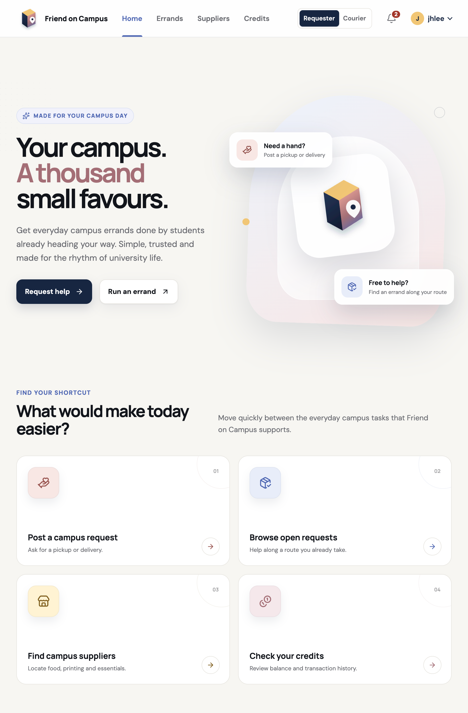

# Friend on Campus

> A campus-only errand marketplace that connects students who need a hand with students already
> heading their way.

[Open the live application](https://d3o63jpdjqzcog.cloudfront.net/)

Friend on Campus (FoC) helps students request pickups and deliveries from campus stores and
facilities. Other verified students can accept those requests, complete the trip, and earn credits.
FoC uses a closed credit economy: credits circulate within the platform and cannot be bought,
withdrawn, or exchanged for money.

Developed for **CS3219 — Software Design and Architecture (AY2026/27 Semester 1)**.

## Features

- **Requester and courier modes** — post an errand or find one that fits a journey you are already
  making.
- **End-to-end errand tracking** — accept, pick up, deliver, confirm, cancel, or report an errand
  with a clear activity trail.
- **In-app chat** — coordinate an accepted errand without leaving FoC.
- **Campus supplier directory** — find food, printing, retail, and other useful campus services.
- **Credit wallet** — reserve a reward when posting, receive payment after completion, and review
  transaction history.
- **Notifications** — follow important updates from the notification bell in the shared header.
- **Campus identity and administration** — verified institutional accounts, role-aware access, and
  audited administrative workflows.

## Visuals

<p align="center">
  <a href="https://d3o63jpdjqzcog.cloudfront.net/">
    
  </a>
</p>

## Using Friend on Campus

### 1. Create an account

1. Visit the [live Friend on Campus application](https://d3o63jpdjqzcog.cloudfront.net/).
2. Select **Create account** and register with a supported NUS-affiliated email address.
3. Enter the six-digit verification code sent to your email, then sign in.

### 2. Request help

1. Select **Requester** in the header.
2. Choose **Request help**.
3. Add an errand title, pickup and drop-off locations, pickup deadline, credit reward, and any
   collection details the courier needs.
4. Review the credit reservation and select **Post errand**.
5. Follow the errand from **My errands**. Once the courier marks it as delivered, confirm receipt
   to release the reward.

### 3. Run an errand

1. Select **Courier** in the header.
2. Choose **Run an errand** or open **Errands** to browse available requests.
3. Filter by reward when needed, open a suitable request, and select **Accept errand**.
4. Use the errand chat to coordinate with the requester.
5. Mark the errand as **picked up** and then **delivered** as the trip progresses. The reward is
   paid after the requester confirms delivery.

### 4. Use the rest of the app

- Open **Suppliers** to browse campus stores and facilities.
- Open **Credits** to view available and reserved credits and transaction history.
- Select the **notification bell** for recent updates.
- Open the **account menu** to manage your profile, change your password, or sign out.

## Architecture

FoC is a microservice application. The stateless gateway presents one browser origin while each
domain service owns its data and enforces authorization locally.

| Component | Responsibility | Documentation |
| --- | --- | --- |
| Gateway | Public entry point, routing, and packaged frontend delivery | [Gateway guide](gateway-service/README.md) |
| User | Registration, authentication, profiles, roles, and account administration | [User guide](user-service/README.md) |
| Supplier | Campus locations and the public/admin supplier directory | [Supplier guide](supplier-service/README.md) |
| Order | Errand creation, matching, and lifecycle | [Order guide](order-service/README.md) |
| Credit | Balances, reservations, transfers, and ledger history | [Credit guide](credit-service/README.md) |
| Chat | Errand conversations, attachments, translation, and activity evidence | [Chat guide](chat-service/README.md) |
| Notification | User-facing lifecycle notifications | [Notification guide](notification-service/README.md) |
| Admin | Case review and administrative actions | [Admin runtime guide](admin-service/RUNTIME_INTEGRATION.md) |

Kafka carries owner-defined domain events between services. Cross-service schemas and examples
live in the [contract package](docs/contracts/README.md).

## Running locally

### Prerequisites

- Docker Desktop or another Docker Engine installation
- Docker Compose v2
- Git

### Docker Compose

```bash
git clone <repository-url>
cd FoC-Team-12
cp .env.example .env
# Fill in the required local credentials and signing keys in .env.
docker compose up --build
```

Open [http://localhost:8088](http://localhost:8088) for the application or
[Gateway Swagger UI](http://localhost:8088/swagger-ui/index.html) for the API catalogue. Direct
service ports are intended for service-owner debugging, not the normal browser journey.

For other environments, follow the dedicated guides:

- [Local Minikube deployment](deploy/k8s/README.md)
- [AWS staging deployment](deploy/aws/README.md)
- [Kafka and local broker operations](deploy/kafka/README.md)
- [CI image publishing and updates](.github/README.md)

## Repository layout

```text
.
├── gateway-service/       # Shared application entry point
├── user-service/          # Identity and access
├── supplier-service/      # Campus suppliers and locations
├── order-service/         # Errand lifecycle
├── credit-service/        # Closed credit economy
├── chat-service/          # Conversations and activity evidence
├── notification-service/  # User notifications
├── admin-service/         # Administrative case workflows
├── deploy/                # Local and cloud deployment assets
└── docs/                  # Shared contracts and integration decisions
```

## Authors and acknowledgments

| Contributor | Primary responsibility | Additional responsibility |
| --- | --- | --- |
| Darryl | User Service | Admin Service and Dashboard |
| Jun Hui | Supplier Service | Broker reliability, delivery/recovery tooling, and observability |
| XueTing | Order Service | Notifications, lifecycle events, and transitions |
| Eldridge | Credit Service | Chat, translation, and the activity timeline |

Cloud infrastructure, integration, CI/CD, responsive end-to-end flows, demonstrations, and the
final submission are shared team responsibilities. Thanks to every contributor and to the CS3219
teaching team for the guidance and feedback that shaped the project.
